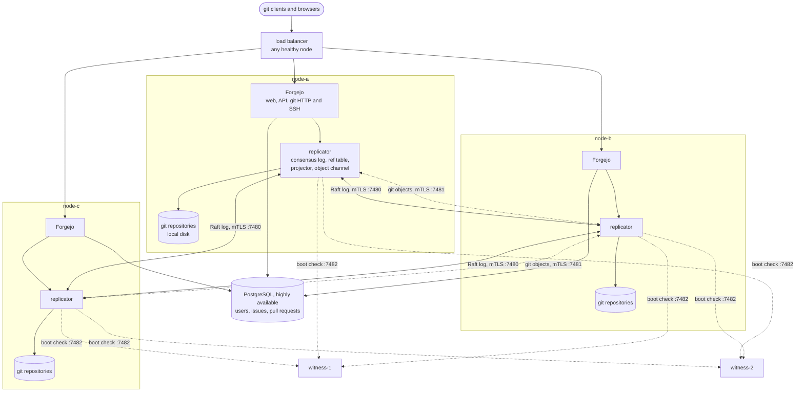
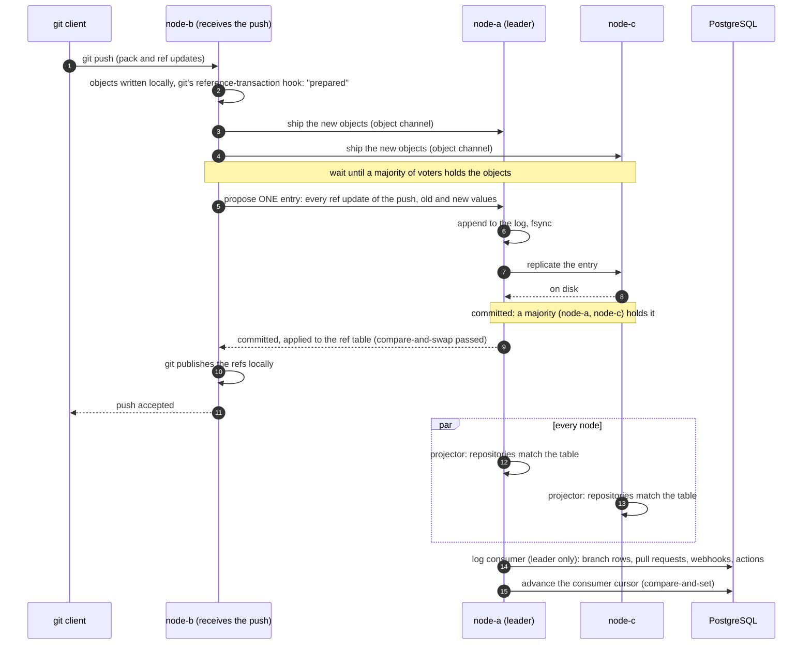
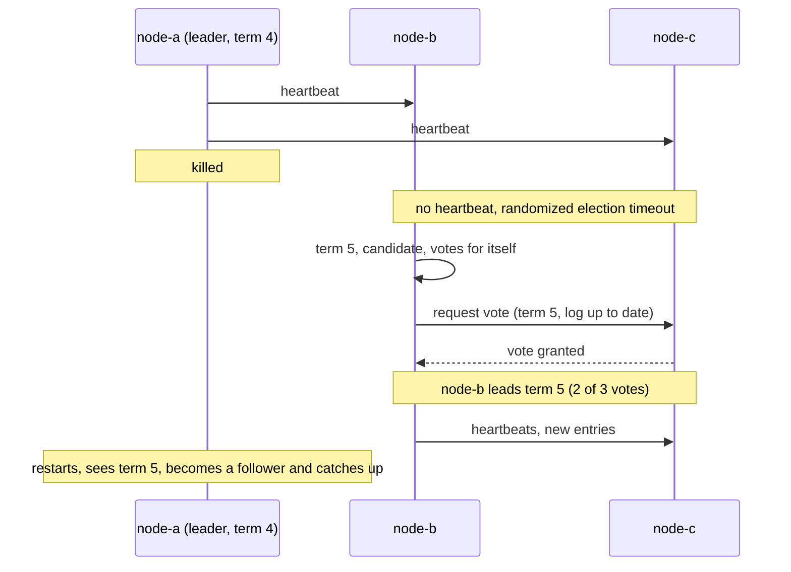
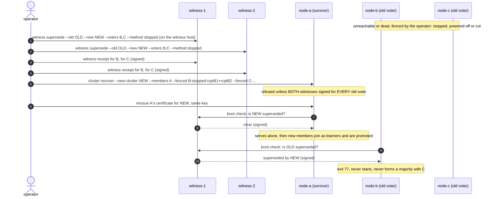

# forgejo-raft

**Forgejo, active-active, on three machines, with no shared disk.**

forgejo-raft is [Forgejo](https://forgejo.org) plus a cluster mode. Three
Forgejo nodes all accept reads and writes. Every change to a git ref (a
push, a merge, a branch deleted from the web UI) goes through a
[Raft](https://raft.github.io/) consensus log and is acknowledged only once a
majority of the nodes holds it, objects included, on disk. Lose any one
machine and the forge keeps serving, pushes included, with nothing lost.

> **Status: experimental.** The cluster mode lives on this repository's
> `forgejo` branch. It is not part of upstream Forgejo. Read
> [Limits and status](#limits-and-status) before trusting it with data you
> cannot rebuild.

The default branch, `forgejo`, is upstream Forgejo plus the cluster mode.
Upstream reaches it every day through a pull request from `sync/upstream`,
which merges itself once the checks are green. This page lives in `.github/README.md` so that GitHub shows it while the
upstream `README.md` stays untouched and upstream syncs never conflict.

## Contents

- [Why](#why)
- [Raft in five minutes](#raft-in-five-minutes)
- [Architecture](#architecture)
- [What happens on a git push](#what-happens-on-a-git-push)
- [When things fail](#when-things-fail)
- [Certificates](#certificates)
- [Operating the cluster: /admin/cluster](#operating-the-cluster-admincluster)
- [Quick start: the Docker lab](#quick-start-the-docker-lab)
- [Production deployment](#production-deployment)
- [Configuration reference](#configuration-reference)
- [Releases](#releases)
- [Limits and status](#limits-and-status)
- [Credits and license](#credits-and-license)

## Why

A single Forgejo is simple and fast, and it is a single point of failure:
when its machine, disk or data center goes, the forge goes with it until a
backup is restored, and whatever was pushed since the last backup is gone.

The usual answer is shared storage: several Forgejo processes in front of one
NFS export, one Ceph or GlusterFS volume, one replicated block device. That
moves the single point of failure into the storage layer, and git on a
network filesystem brings its own trouble: lock files, `fsync` semantics,
latency on every object read. Active-passive setups (DRBD, a standby that
mounts the disk on failover) avoid concurrent access but leave one node
idle and need fencing anyway.

forgejo-raft takes another route, the one databases took long ago: replicate
the *decisions*, not the disk.

| | Single Forgejo | Shared storage | forgejo-raft |
|---|---|---|---|
| Survives a machine loss | no | if the storage survives | yes, any one of three |
| Writes accepted on | one node | every node, one filesystem | every node |
| Acknowledged push is on | one disk | the storage's guarantee | a majority of disks |
| Repositories live on | local disk | network filesystem | local disk, on every node |
| Split brain | n/a | the storage's problem | impossible by construction (majority) |
| Extra infrastructure | none | a storage cluster | none for git, an HA PostgreSQL for SQL |

Each node keeps complete git repositories on its own local disk. What the
nodes agree on, through Raft, is the **ref table**: for every repository,
every ref and the commit it points to. A node's repositories are a
*projection* of that table. Git objects travel beside the log, on their own
channel, and reach a majority before the ref that names them is proposed.

## Raft in five minutes

Raft is a consensus protocol: a way for a group of machines to agree on one
ordered sequence of decisions, even when some of them crash or the network
splits. The cluster's vocabulary:

- **Log.** An ordered list of entries ("set `refs/heads/main` of
  `alice/app` to `9fab...`"). Every node holds a copy. Applying the same log
  in the same order gives every node the same ref table.
- **Leader.** One node at a time orders new entries. Any node accepts a
  push; the entry is proposed to the leader, which appends it and sends it
  to the others (the **followers**).
- **Majority (quorum).** An entry is **committed** once a majority of the
  voting nodes has written it to disk: 2 of 3. A committed entry is never
  lost or undone, because any future majority overlaps the one that holds
  it. Three nodes tolerate one failure; five would tolerate two.
- **Term.** Time is divided into numbered terms, each with at most one
  leader. A node that hears of a higher term steps down. Terms are how a
  deposed leader learns it is no longer in charge.
- **Election.** Followers expect regular heartbeats from the leader. When
  they stop, a follower waits a randomized timeout, increments the term and
  asks for votes. A node votes for at most one candidate per term, and only
  for a candidate whose log is at least as complete as its own. The first
  candidate to collect a majority leads. In practice: one or two seconds.
- **Learner.** A non-voting member. It receives the log and snapshots but
  does not count toward the majority. A new node always enters as a learner,
  catches up, and is then **promoted** to voter; the engine refuses to
  promote a learner that still lags. Adding a cold, empty voter directly
  would weaken the majority while it copies everything.
- **Snapshot.** A node far behind does not replay years of log: it receives
  the ref table as of some index, then the log after it.

Two consequences matter for operators. A node cut off from the majority can
no longer commit anything, so it refuses writes instead of diverging. And
the cluster's capacity to survive is visible at all times as its **failure
tolerance**: 1 when all three are healthy, 0 when one is down.

## Architecture



The pieces, all inside the Forgejo binary:

- **The consensus engine** is
  [`github.com/kitsunium/sdk`](https://github.com/kitsunium/sdk), package
  `app/consensus`: a Raft log with durable `fsync`, pre-vote, learners,
  one-at-a-time membership changes and snapshots. Its design is ADR 0152 of
  that repository. Forgejo uses it through a small driver interface
  (`[cluster] DRIVER = kitsunium`).
- **The ref table** is the replicated state machine. Applying an entry
  checks that every ref still has the value the writer saw (a
  compare-and-swap per ref), so two concurrent pushes to the same branch
  cannot both win.
- **The projector** is the only thing that writes refs into a node's git
  repositories. It makes them match the table, fetching any missing object
  from the other members, and certifies a per-repository watermark once a
  repository matches.
- **The object channel** moves git objects between members over mutual TLS.
- **The hook path.** Git's `reference-transaction` hook turns every native
  ref update into a proposal, over a private Unix socket. User-defined git
  hooks are therefore disabled (`[security] DISABLE_GIT_HOOKS = true` is
  enforced): they would run inside the replication path.
- **The log consumer** derives SQL from the log, on the leader only (see
  below).

PostgreSQL is shared and **not** replicated by the cluster: issues, pull
requests, users and settings live there as in any Forgejo. It must be highly
available on its own (Patroni, a managed service, a Kubernetes operator).
Keep sessions in the database too (`[session] PROVIDER = db`), so that any
node can serve a user's next request.

## What happens on a git push



Step by step:

1. **Objects first.** The receiving node stores the pack, then ships the new
   objects to the other members until a majority holds them. A ref is never
   committed before the objects it names are on a majority of disks, so a
   committed ref can always be served after any single failure.
2. **One entry per git transaction.** Git's `reference-transaction` hook, in
   its `prepared` phase, hands every ref update of the push to the
   replicator. They become a single log entry, so a multi-branch push is
   all-or-nothing.
3. **Commit.** The leader appends the entry and replicates it. Once a
   majority has it on disk, it is committed. Applying it checks each ref's
   expected old value: a concurrent push that moved the branch meanwhile
   makes this one fail cleanly, exactly like a non-fast-forward on a single
   Forgejo.
4. **Publish.** Only then does git, on the receiving node, publish the refs.
   If the entry did not commit (no majority, leader lost), git publishes
   nothing and the client sees the push rejected; retrying is safe.
5. **Project.** Every node's projector makes its local repository match the
   table, fetching objects it lacks.

**The SQL side.** On a single Forgejo, a push triggers "post-receive" work:
update the branch list, close or update pull requests, fire webhooks, start
CI. In the cluster that work runs on the **leader**, by one consumer that
reads committed events from the log in order. Its position is a cursor
stored in PostgreSQL and advanced by compare-and-set in the same transaction
as the SQL work: the database changes (branch rows, pull request updates,
webhook and CI tasks) commit exactly once with the cursor, and a webhook
task created again on replay is the same task. What happens outside the
database after that commit, sending webhooks and running CI jobs, is
asynchronous: it is queued once the transaction commits and retried by its
own queue, so a delivery can be late or repeated, never lost with the
transaction. When leadership moves, the new leader rebuilds its queue from
the events past the cursor: no SQL work is skipped or done twice. Git data
is consistent at commit time; the SQL rows (the branch list in the web UI,
for instance) follow within moments.

**Read your own writes.** A request that wrote refs gets a short-lived
cookie naming its log entry. If the next request lands on a node that has
not applied that entry yet, the node waits for it (up to
`READ_AFTER_WRITE_TIMEOUT`, 2 s by default), so a user never sees their own
push disappear when the load balancer switches nodes.

## When things fail

### One node down

The other two still form a majority. Reads and pushes continue on them;
failure tolerance drops to 0 and `/api/healthz` on the leader warns about
it. When the node returns, it catches up from the leader's log, or from a
snapshot if it was away long, then its projector brings its repositories up
to date. It reports ready only once it has caught up.

### The leader is killed



A push in flight on the dead leader is either committed (a majority already
had it: it survives and the new leader serves it) or not (the client gets an
error and retries). The lab measures this: a push started right after the
leader is SIGKILLed is accepted by another node well within its 15 second
bound, usually in one or two seconds.

### A network partition

The side with the majority elects a leader if it needs one and keeps
accepting writes. The minority side cannot commit anything: a node there
rejects pushes rather than accepting writes it cannot make durable. An old
leader isolated in the minority steps down as soon as it learns of the
higher term. When the partition heals, the minority catches up. There is no
split brain to reconcile, because nothing was committed on the minority
side.

### Two nodes lost: Recover, and the witness fence

With two of three nodes gone for good (two disks destroyed, two machines
reclaimed), no majority remains and the cluster cannot commit. The way out
is `forgejo cluster recover`: on the survivor, offline, it forces a new
configuration under a **new cluster id**. This is the one operation that can
lose data (whatever only the lost nodes held) and the one that could create
a split brain: if the two "lost" nodes were only unreachable and come back,
they still form a majority of the *old* cluster.

The **witnesses** close that hole. A witness is a tiny signed service
(`forgejo cluster witness serve`) on two hosts that fail independently of
the nodes. It records which clusters a Recover superseded. Every node asks
the witnesses at boot, before opening its data, and refuses to start (exit
code 77) if any witness says its cluster was superseded, or if none
answers. Recover itself refuses to run without a signed receipt from each
witness for each old voter.



Notes:

- The superseded record is written **only on the witness host**, with the
  CLI, never over the network. The network API only answers questions, with
  Ed25519 signatures the nodes verify against `WITNESS_KEYS`.
- Under a supervisor, exit code 77 means "fenced, do not retry". The Nomad
  job runs the check as a `prestart` task and never reschedules; the
  Kubernetes example runs it as an init container.
- A one-boot override exists for the operator who knows better
  (`FORGEJO_CLUSTER_WITNESS_OVERRIDE`, checked against
  `WITNESS_OVERRIDE_SHA256`). Its use is logged.
- Other recovery tools: `forgejo cluster snapshot save` (online) and
  `forgejo cluster restore` (offline, into an empty directory) for the ref
  table; `forgejo cluster objects verify|backfill` for missing objects;
  `forgejo cluster reconcile [--apply]` to compare SQL with the ref table
  after a database restore or failover; `forgejo cluster quarantine clear`
  after a corrupted log; `forgejo cluster inspect` to read a data directory
  offline.

## Certificates

Members authenticate each other by mutual TLS on both channels. A node's
certificate carries exactly **one URI SAN**:

```
kitsunium-consensus://<CLUSTER_ID>/slot/<SLOT>
```

with both the `serverAuth` and `clientAuth` extended key usages, and chains
to the cluster's CA (`TLS_CA_FILE`). On top of that, every member is
**pinned on its public key** (the SHA-256 of its SPKI) in the replicated
membership: a valid certificate for the right slot with another key is
still refused. Consequences:

- The node's private key belongs to that node alone. With the Vault renewer
  and the Compose and Nomad examples it is generated on the node and never
  leaves it. On Kubernetes, cert-manager draws it and keeps it in that
  slot's Secret, which only that slot's pod mounts; anyone allowed to read
  Secrets in the namespace can read it too.
- A renewal must reuse the same key. Every example here does: the Vault
  renewer signs a CSR made from the key on disk; cert-manager uses
  `rotationPolicy: Never`.
- A **slot** is a stable name for a seat in the cluster (`node-a`), bound to
  a machine. The certificate names the slot, so a node cannot claim another
  seat.

**The Vault renewer.** With `RENEW_VAULT_ADDR` set, each node renews its own
certificate in process, at two thirds of its lifetime plus a per-node jitter
(so the three nodes never renew together), by having Vault sign a CSR at
`pki-consensus/sign/<slot>`. Vault's role for a slot allows exactly that
slot's URI SAN and nothing else (`require_cn=false`, `allowed_uri_sans` set
to the one URI, no SAN taken from the CSR). Under Nomad the node logs in to
Vault with its **workload identity**: a JWT that Nomad writes into the task,
accepted by a Vault JWT auth role bound to the exact `nomad_namespace`,
`nomad_job_id` and `nomad_task`. A task can only ever obtain a certificate
for its own slot. A token file (`RENEW_VAULT_TOKEN_FILE`) is the fallback,
and its use is logged. `forgejo cluster cert renew` renews on demand.

A renewed file is picked up at the next TLS handshake on both sides. The
object channel also recycles its open connections when the file changes;
consensus connections end naturally, and are bounded by the expiry of the
certificate that opened them.

## Operating the cluster: /admin/cluster

**Site Administration > Cluster** (`/admin/cluster`) shows, for every site
administrator:

- this node: role, term, leader, commit and applied index, lineage, failure
  tolerance, certificate expiry, a fingerprint of the ref table;
- every member's progress, lag and reachability (known by the leader: open
  the page on the leader for this part);
- replicated alarms, such as the disk space alarm;
- per-repository projection lag;
- the replicated audit log of operations, with the operator who ran each.

Only **cluster operators** may act. The permission is seeded once by
`OPERATORS` and then managed from the page or with
`forgejo cluster operator add|remove|list` on a node (the way back in if
nobody holds it). The operations: add a learner, promote, remove, transfer
leadership, authorize a node to join (optionally pinned to its key), update
a member's address, deny a key, clear the disk space alarm, grant and revoke
the operator permission.

Each operation asks the operator to **retype its target** and to
**step up**: a fresh re-authentication. An operator linked to the OpenID
Connect source named by `STEP_UP_OIDC_SOURCE` re-authenticates at that
provider with a forced login (`prompt=login`, `max_age=0`) and, when
`STEP_UP_ACR` is set, the required authentication class (for instance a
hardware key); their password is then not accepted. Other accounts, such as
a local break-glass administrator, give their password and TOTP code. A
step-up stays valid for `STEP_UP_MAX_AGE` (5 minutes). An operation can be
submitted on any node, which forwards it to the leader. No API route leads
to these operations.

Monitoring: with `[metrics] ENABLED = true`, `/metrics` exposes
`consensus_*` (role, term, failure tolerance, commit, apply and fsync
latencies, per-peer lag on the leader) and `forgejo_cluster_*` (readiness,
pending projection, event queue, consumer lag, git transactions in flight,
certificate expiry). `/api/healthz` is ready only when the node follows a
known leader and its repositories have caught up once since it started; on
the leader it also reports the failure tolerance, the gate for a rolling
upgrade.

## Quick start: the Docker lab

The lab (`contrib/cluster-lab`) is a
disposable, complete setup on one machine: three Consul servers, three
PostgreSQL 18 under Patroni behind HAProxy, a lab PKI, three Forgejo nodes,
two witnesses, a development Vault and a development Nomad. About 1.2 GB of
memory in use, 3.4 GB at most. Docker with Compose v2 is all it needs.

```sh
git clone https://github.com/kodflow/forgejo-raft.git
cd forgejo-raft
cd contrib/cluster-lab

export FORGEJO_SRC="$PWD/../.."   # the tree the image is built from

make help          # every target
make up            # build the images, start everything
make bootstrap     # found the cluster: init and bootstrap on each node
make status        # Consul, Patroni, HAProxy, and each node's role and term
make e2e           # push through one node, read on another, kill the leader, fail PostgreSQL over
make chaos-e2e     # partitions and restarts, each one verified
```

The three nodes answer on `http://localhost:3001`, `:3002` and `:3003`. The
lab's secrets are random, in a git-ignored `.env`:
`make secret NAME=LAB_ADMIN_PASSWORD` prints the admin password once `make
e2e` has created the account.

Failure drills:

```sh
make chaos SCENARIO="forgejo 2"     # stop a node
make chaos SCENARIO="partition 3"   # cut a node off the network
make chaos SCENARIO="pg-primary"    # stop the PostgreSQL primary
make heal                           # undo every scenario
make failover                       # a Patroni failover behind HAProxy, alone
```

The advanced proofs:

```sh
make witnesses        # start the two witnesses, turn the boot fence on
make recover-e2e      # DESTRUCTIVE: lose the majority, Recover, prove the old pair is fenced
make vault-renew-e2e  # Vault signs each node's renewal from its own key
make nomad-e2e        # Vault login by workload identity, witness prestart exit 77, JOIN refused on a draining node
make reset            # stop everything and wipe the volumes (secrets in .env are kept)
```

`contrib/cluster-lab/RESULTS.md` holds the real output of a full run from
scratch.

**Even smaller:** `contrib/cluster/deploy/compose` runs three nodes and one
PostgreSQL with a single `./bootstrap.sh`, nothing else. Good for a demo; it
shares one host, so it survives the loss of a process, not of the machine.

## Production deployment

### What you need

- **Three machines** in three failure domains (racks, zones, providers),
  each with a local, persistent, ideally encrypted disk for the data
  directory (`DATA_DIR`, never a tmpfs) and the repositories. Raft
  round-trips set the commit latency: keep the nodes within a few tens of
  milliseconds of each other.
- **A private network** between them: the consensus (`:7480`) and the
  object channel (`:7481`) must never face the internet. `LISTEN_ADDR` names
  the node's private address explicitly; a wildcard is refused.
- **PostgreSQL, highly available**, reachable from every node, with backups
  of its own. The cluster does not replicate SQL.
- **Object storage for non-git files.** The cluster replicates git refs and
  objects (repositories and wikis). LFS objects, attachments, avatars and
  packages live in Forgejo's `[storage]`: point it at an S3-compatible store
  shared by the nodes.
- **A CA** for the cluster, ideally Vault's PKI engine for in-process
  renewal, or cert-manager on Kubernetes.
- **Two witness hosts** for the Recover fence, failing independently of the
  three nodes (another provider, another site). A witness is the Forgejo
  binary with `cluster witness serve`; it needs almost nothing.
- **A load balancer** in front of the nodes, health-checking
  `/api/healthz`. Any ready node serves reads and writes.

### Founding the cluster

The nodes are stopped and share one configuration except `SLOT`,
`LISTEN_ADDR` and the TLS files.

```sh
# on each node, offline: prints id:incarnation:slot:spki:host:port
forgejo cluster init

# on each node, offline, with the SAME three lines everywhere
forgejo cluster bootstrap --members "<line-a>,<line-b>,<line-c>"

# start the three servers; a leader is elected within seconds
forgejo cluster status

# repositories that predate the cluster, once, on the node that holds them
forgejo cluster import

# give someone the operator permission
forgejo cluster operator add <login>
```

### Adding or replacing a node

A slot can have only one member. For a **new slot**, add the new node first,
then remove the old one: the cluster keeps its tolerance throughout. To
**replace the machine of an existing slot**, remove the old member first
(the cluster runs without tolerance in between: check that the other two
are healthy, and replace one node at a time). Then:

1. On the new node, `forgejo cluster init`, start the server.
2. In `/admin/cluster`, **authorize a join** for its slot (it joins by
   itself as a learner), or **add a learner** with its member line.
3. `forgejo cluster objects verify` on it, `backfill` if anything is
   missing.
4. **Promote** the learner once caught up. Transfer leadership away from a
   node before removing it.

### Deployment examples

Generic, commented, validated with their own tools, under
[`contrib/cluster/deploy`](../contrib/cluster/deploy):

| Path | What it is |
|---|---|
| [`compose/`](../contrib/cluster/deploy/compose) | Three nodes and one PostgreSQL on one Docker host. `./bootstrap.sh` generates the secrets, the PKI and the cluster. Tried end to end: push on one node, read on the others, leader killed, push accepted within a second on another node. |
| [`nomad/`](../contrib/cluster/deploy/nomad) | One job, one group per slot pinned on its machine, never rescheduled; the witness check as a `prestart` task; workload identities for Vault and for the JOIN drain check. Plus the Nomad ACL policy (`node:read`, `read-job`), and `vault-setup.sh`: the PKI mount with one role per slot (`require_cn=false`, exact `allowed_uri_sans`) and the JWT auth mount with one role per slot bound to `nomad_job_id` and `nomad_task`. |
| [`kubernetes/`](../contrib/cluster/deploy/kubernetes) | `kubectl apply -k`: one StatefulSet of one replica per slot, from one template, each mounting only its own certificate Secret; required pod anti-affinity, a headless Service for the consensus, one PVC per pod, the witness check as an init container, one cert-manager Certificate per slot with its URI SAN, a PodDisruptionBudget, and PostgreSQL left external. The private keys live in the slots' Secrets: restrict who can read Secrets in the namespace. |

On Nomad, the job relies on: a host volume per machine, each client's meta
`forgejo_slot`, the ACL policy attached to the job, Vault configured by the
script, and a Nomad Variable with the database password and secret key.
Nomad never moves a member (`reschedule { attempts = 0 }`,
`disconnect { replace = false }`): Raft decides who holds the data, not the
scheduler. Before admitting a node that joins by itself, Forgejo reads
Nomad (read-only) and refuses the join while that machine is draining,
ineligible or not ready.

### Upgrades and backups

- **Rolling upgrade:** one node at a time, waiting for `/api/healthz` to be
  ready again and the leader's failure tolerance to be back to 1 before the
  next. Both the Nomad job and the StatefulSet encode this.
- **Backups:** PostgreSQL as usual; `forgejo cluster snapshot save` for the
  ref table (with its SHA-256 beside it); the repositories of any one node.
  After restoring the database, `forgejo cluster reconcile` lists what SQL
  and the ref table disagree on, and `--apply` rebuilds the regenerable
  rows.

## Configuration reference

The `[cluster]` section of `app.ini` (also settable as
`FORGEJO__cluster__KEY` environment variables in the container image).
`custom/conf/app.example.ini` documents every key.

| Key | Default | Purpose |
|---|---|---|
| `ENABLED` | `false` | Turns the replicator on. Requires `[security] DISABLE_GIT_HOOKS = true`. |
| `SLOT` | required | This node's seat, `[a-z0-9-]{1,32}`, named by its certificate. |
| `CLUSTER_ID` | | 32 lowercase hex digits, used by `cluster init`. |
| `LISTEN_ADDR` | required | Consensus listener on the private address, never a wildcard. |
| `OBJECT_PORT`, `OBJECT_LISTEN_ADDR`, `OBJECT_PEERS` | `7481` | The object channel. |
| `PEERS` | | Seeds, `slot=host:port,...`; the committed membership rules afterwards. |
| `TLS_CERT_FILE`, `TLS_KEY_FILE`, `TLS_CA_FILE` | required | The node's certificate and key, the cluster CA. |
| `DATA_DIR` | `<APP_DATA_PATH>/cluster` | The log and snapshots. Never on a tmpfs. |
| `HOOK_SOCKET` | `<APP_DATA_PATH>/cluster-run/hook.sock` | Private socket for git hooks and the CLI. |
| `OPERATORS` | | Bootstrap only: logins given the operator permission when nobody holds it. |
| `STEP_UP_MAX_AGE`, `STEP_UP_OIDC_SOURCE`, `STEP_UP_ACR` | `5m` | Re-authentication before an operation. |
| `READ_AFTER_WRITE_TIMEOUT` | `2s` | How long a request waits for the caller's last write. |
| `WITNESSES`, `WITNESS_KEYS`, `WITNESS_OVERRIDE_SHA256` | | The Recover fence. |
| `RENEW_VAULT_*`, `RENEW_TTL` | off | The in-process certificate renewer. |
| `NOMAD_ADDR`, `NOMAD_TOKEN_FILE`, `NOMAD_SLOT_META` | off | The JOIN drain check. |
| `MAX_LOG_BYTES`, `MAX_SNAPSHOT_BYTES`, `ACK_MARGIN`, `TXN_TTL`, `MAX_TXN_PER_REPO`, `MAX_TXN_TOTAL`, `JOIN_GRANT_TTL` | | Bounds. |

## Releases

Two lines of releases, both built and published by the same workflow
(`.github/workflows/release-publish.yml`), with no manual step.

**The development line**, `.github/workflows/release.yml`: every merge that
brings cluster code to the `forgejo` branch.

- **Version** `v<upstream>-raft.<N>`, for example `v18.0.0-dev-raft.1`.
  `<upstream>` is the upstream Forgejo version the code is built on, found
  as Forgejo's Makefile finds it (`git describe` on the nearest upstream
  tag). `<N>` counts the releases on that upstream version and starts again
  at 1 when it changes. `forgejo --version` reports the same version.
- Published as a **prerelease**, image alias `:dev`.
- **Notes** list the cluster commits since the previous release, upstream
  commits left out.
- **Upstream syncs and tooling changes release nothing.** A push releases
  only when it brings a commit that is in neither the previous release nor
  upstream Forgejo and changes something outside `.github/`,
  `.coderabbit.yaml` and `contrib/cluster-lab/`.

**Official Forgejo releases**, `.github/workflows/upstream-releases.yml`:
every official release gets its raft release, `vX.Y.Z-raft.N`, the day it is
announced.

- **Which**: the versions Forgejo declares supported in the TXT record of
  `release.forgejo.org` (what Forgejo's own update checker reads), that is
  the newest release of each supported major, LTS included. Checked daily
  after the upstream sync. No backfill: an older release is built on demand
  (`tag` input). Release candidates are not built.
- **How**: the raft delta (what `forgejo` changes relative to the upstream
  commit it last merged, tooling excluded) is applied onto the official tag
  by a three-way merge, committed on the branch `release/vX.Y.Z` with the
  tag as its only parent. Never a merge of `forgejo` into the tag, which
  would bring upstream's development commits. The run checks it: no commit
  of upstream's development branch or of `forgejo` after the tag, no file
  changed outside the delta. When a later patch release conflicts, the
  branch of the previous one of the same major, already resolved, is
  carried onto it instead.
- **Gate**: cluster-checks and the E2E suites on `release/vX.Y.Z`, then a
  release (not a prerelease), marked Latest and image `:latest` when it is
  the highest stable raft version.
- **Blocked**: a conflict or a red check releases nothing and opens the
  issue `raft release vX.Y.Z blocked`, with the files or the failed jobs
  and how to fix it on `release/vX.Y.Z`. The next run tests the branch as
  it stands.
- **Notes** link the official release notes and summarize the raft delta.
- **Assets** of both lines: static `forgejo` binaries for linux/amd64 and
  linux/arm64 (SQLite, embedded assets) and their `SHA256SUMS`, plus the
  image `ghcr.io/kodflow/forgejo-raft:<version>`, built with Forgejo's own
  Dockerfile. The binaries are the ones inside the image.

`.github/scripts/release-plan.sh --dry-run` shows, from a local clone, the
version and notes a push of the current commit would produce, and
`TAG=vX.Y.Z .github/scripts/raft-release-branch.sh --dry-run` what an
official release would give (clean, carried, or the conflicted files).

### Knowing that a release is out

- **In Forgejo**: the update checker (`[cron.update_checker]`, weekly by
  default) also reads the raft release index. The admin dashboard then
  says, next to Forgejo's own notice that an official release is out,
  either that `forgejo-raft X.Y.Z-raft.N` is available or that the raft
  build of `X.Y.Z` is not available yet. The index is `releases.json` on
  the branch `release-index`, rewritten after every release;
  `RAFT_ENDPOINT` points elsewhere, or is set empty to turn this off.
- **Feed**: https://github.com/kodflow/forgejo-raft/releases.atom
- **GitHub**: Watch, Custom, Releases on this repository.
- **Images**: `ghcr.io/kodflow/forgejo-raft`, tags `vX.Y.Z-raft.N`,
  `:latest` (highest stable) and `:dev` (development line).

## Limits and status

- **Experimental, unreleased.** The cluster mode is in review and has not
  been run in production for long. The consensus library is pre-1.0 and
  pinned to a specific revision.
- **Three voters.** The tooling and examples target three voting members.
- **Git hooks are disabled** cluster-wide (server-side hooks in the
  repository settings). Webhooks and Forgejo Actions work as usual.
- **Every ref write must go through Forgejo.** Editing a repository on disk
  behind Forgejo's back is not replicated; the projector will put the refs
  back to what the table says.
- **Writes need a majority.** With one node left, nothing can be committed:
  pushes are refused until a second node is back, or until an operator runs
  Recover.
- **The SQL side is eventually consistent** with git by a few moments: the
  branch list or a pull request's state follows the push, computed once on
  the leader.
- **Non-git data** (LFS, attachments, packages) must be on shared object
  storage; the cluster does not replicate it.
- The Nomad JOIN drain check looks at the joiner's machine only. Checking
  that the old member's machine was emptied stays the job of the operator
  who authorizes the join.
- Forgejo has no tracing: the consensus engine's spans are not exported.

Feedback, bug reports and test results are welcome as GitHub issues on this
repository. Problems with Forgejo itself belong upstream, on
[Codeberg](https://codeberg.org/forgejo/forgejo).

## Credits and license

All of Forgejo is the work of the [Forgejo](https://forgejo.org) community
and, before it, of the Gitea and Gogs projects. forgejo-raft only adds the
cluster mode on top; everything else is upstream Forgejo, kept in sync on
the `forgejo` branch. The consensus engine is
[kitsunium/sdk](https://github.com/kitsunium/sdk) (MIT license).

forgejo-raft is distributed under the same license as Forgejo, the
**GNU General Public License v3.0 or later** (GPL-3.0-or-later). See
[`LICENSE`](../LICENSE).
